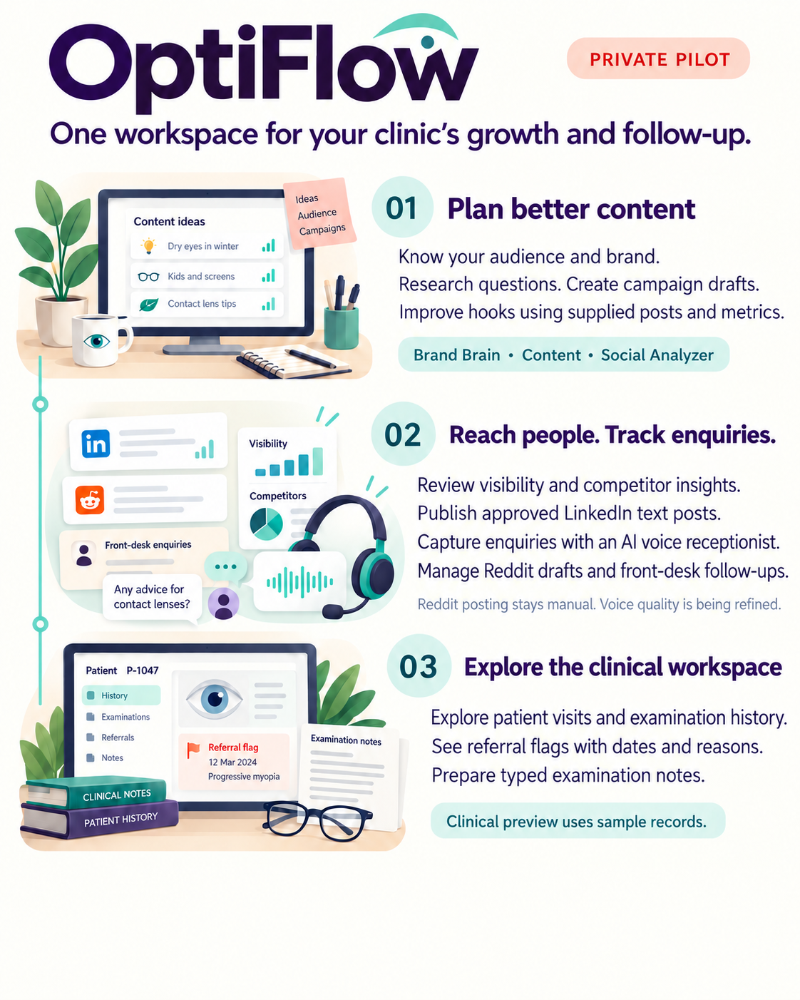
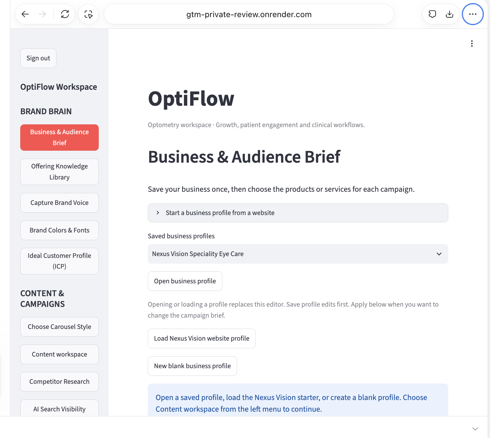

# Meet OptiFlow

### One workspace for your clinic’s growth and follow-up

OptiFlow brings content planning, audience research, social publishing, enquiry follow-up and a clinical workspace preview into one private optometry pilot. Nexus Vision is the first clinic example.

**This explanation is public. No app login is needed to read it.** Access to the working app remains restricted to authorised users.

## Inside the deployed app

The OptiFlow workspace, showing the Business & Audience Brief and sidebar navigation.

## What does it help you do?

### 1. Plan content around the right audience

Save your business, offerings, brand voice and ideal customer profile. Use audience questions and supporting research to prepare campaign content for human review. The Nexus ICP is populated, including working professionals as a priority audience for keratoconus, scleral-lens and dry-eye topics.

### 2. Improve content and reach people

Review competitors and search visibility, improve social hooks and captions, and publish approved LinkedIn text posts. Organise Reddit discussions and draft replies for clinician review and manual posting.

### 3. Capture enquiries and manage follow-up

A separate Sarvam-powered web voice receptionist captures enquiries. OptiFlow’s Front Desk provides the staff workspace for enquiry review and follow-ups. Recording and enquiry capture have worked in the voice-agent project; language switching and interruption quality are still being refined. Automatic calendar booking is not yet complete.

### 4. Explore clinical workflows

The integrated clinical preview brings examination records, visit history, referral details and typed notes together. Its current preview uses sample records: 100 synthetic patients and 137 examinations. Persistent clinical record storage and production clinical controls remain future work.

## Social Media Analyzer, explained

- **Review a draft:** Paste a caption, opening hook or transcript. Get feedback on the hook, call to action, tone, specificity and audience journey stage.
- **Get practical suggestions:** Receive an alternative hook, an improvement to try next and claims that need verification.
- **Compare past posts:** Upload post text and measured performance in JSON. Compare patterns across hook types, themes and other characteristics, separately by account and platform.
- **Apply your findings:** Edit and approve the analysis, then send the reviewed direction into the Content workspace for the next campaign.
- **Keep the report:** Download it or save it with a campaign.

Analysis uses supplied text and metrics. It does not automatically fetch profiles, watch videos, listen to audio or predict virality. Hosted text analysis uses Gemini and requires provider access.

## What is inside each tab?

Explore the workspace by section:

| Area | Tab | Purpose |
| --- | --- | --- |
| Brand Brain | Business & Audience Brief | Save the business, audience and selected offerings for campaigns. |
| Brand Brain | Offering Knowledge Library | Organise offering-specific research and supporting material. |
| Brand Brain | Capture Brand Voice | Record language and tone preferences. |
| Brand Brain | Brand Colors & Fonts | Store visual brand choices. |
| Brand Brain | Ideal Customer Profile (ICP) | Edit and save audience priorities, needs, objections and research assumptions. |
| Content & Campaigns | Choose Carousel Style | Choose the visual direction for carousel content. |
| Content & Campaigns | Content workspace | Work on research-backed content and campaign drafts for human review. |
| Content & Campaigns | Competitor Research | Review competitor positioning and evidence. |
| Content & Campaigns | AI Search Visibility | Workspace for visibility checks and competitor evidence; no guarantee of rankings or AI recommendations. |
| Content & Campaigns | Landing Pages | Work on campaign landing-page material. |
| Content & Campaigns | Results Tracking | Record and review campaign results. |
| Content & Campaigns | Social Media Analyzer | Review social-content insights and hand off findings to campaigns. |
| Content & Campaigns | Social Publishing | Approved manual LinkedIn text publishing. Unattended scheduling is deferred. |
| Content & Campaigns | Reddit Outbound Agent | Saved watchlist, research cases, reply drafts and follow-up review, with Keep/Remove/Restore controls. Kiran posts replies manually. |
| Front Desk | Front Desk | Staff enquiry and follow-up workspace. Full voice-to-calendar booking is not claimed complete. |
| Clinical Workspace | OptiFlow Clinical Workspace | Synthetic examination, history and referral demo, with optional AI views and session-only typed notes. |

### Clinical workspace sections

1. **Dashboard:** synthetic patient/examination totals, filters and referral-marked visit details.
2. **Patient Examinations:** inspect the synthetic examination records.
3. **Patient History:** review visits for a selected synthetic patient.
4. **Ophthalmology Referrals:** explore synthetic referral-directory information.
5. **AI Clinical Summary:** provider-dependent summary interface; provider setup is still required.
6. **Upload Prior Report:** optional provider-assisted review of dummy reports only.
7. **Examination Notes:** type and download draft notes; notes are session-only.

## Current release scope

- **Private pilot:** authorised Google sign-in; this is a shared workspace, not a separate workspace for every clinic.
- **Publishing:** manual LinkedIn text publishing is connected. Hosted scheduling and Instagram/YouTube connections remain future work.
- **Reddit:** research and draft preparation support Kiran, who reviews and posts replies manually.
- **Voice:** enquiry capture exists; conversational quality is being refined. Calendar booking remains pending.
- **Clinical preview:** sample records only at this stage. Typed notes are session-only and downloadable. Clinical AI/report features require provider setup; clinical voice dictation is not enabled.
- **Human review:** clinical/content and ICP review remains pending. AI suggestions are draft assistance, not autonomous clinical decisions.

## See the work

- [Deployed screenshots and 24 October progress](../progress/2026-10-24/README.md)
- [Reddit watchlist and review-queue screenshots](../progress/2026-10-23/README.md)
- [LinkedIn post published through the app](https://www.linkedin.com/feed/update/urn:li:share:7519424798817402880/)
- [Open the private OptiFlow app](https://gtm-private-review.onrender.com/) (authorised access required)

*Updated 24 October 2026. The illustration explains the product; the linked screenshot gallery shows the deployed interface.*
