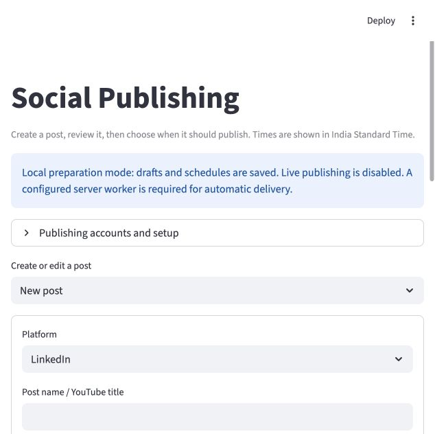
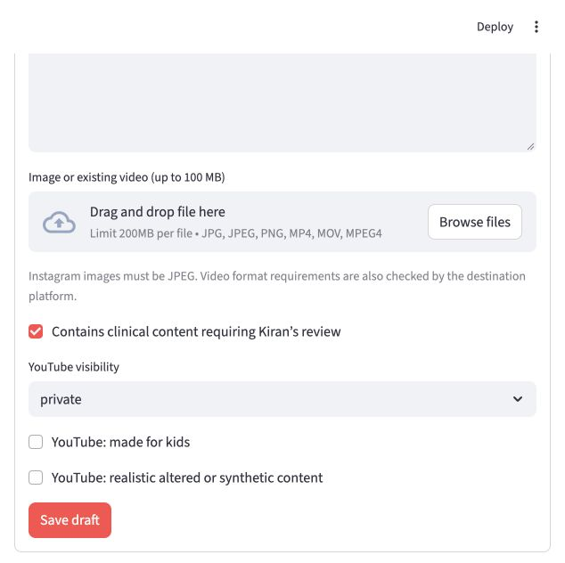
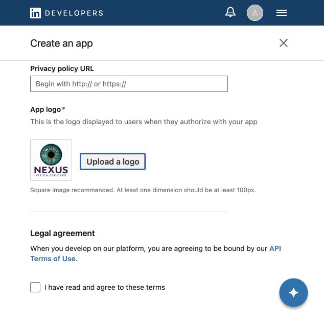

# GTM Agent — 22 October 2026

## Social publishing and brand setup

Today's work moves the GTM Agent from content creation toward reviewed, scheduled social publishing. This page contains actual local application screenshots and the selected AI-generated logo concept.

**Status: local implementation and account setup in progress. Live autoposting is not enabled.**

## 1. Social publishing composer

The local interface includes platform selection, a post title and caption, image/video uploads, and draft saving. The visible preparation-mode notice confirms that automatic delivery still requires a configured server worker.

## 2. Media and review controls

The form includes a clinical-review flag and YouTube visibility, audience and synthetic-content settings. Clinical review by Kiran remains pending.

The local implementation also includes saved scheduling times, approval controls and delivery-status handling. These screenshots demonstrate the composer; they do not establish successful delivery to a social platform.

## 3. LinkedIn developer setup

Created the Nexus Vision Eye Care Company Page and prepared the **Nexus GTM Content Agent** developer-app form with the selected logo. The screenshot below shows the uploaded logo and the unaccepted API terms: app creation and authorization remain incomplete.

## 4. Selected brand concept

Explored logo variations and selected this realistic teal iris with plum Nexus lettering for initial use. It can be refined later.

## Next steps

- Complete LinkedIn developer-app creation and authorization.
- Verify an explicitly approved publishing attempt.
- Configure a persistent worker and media storage before enabling scheduled delivery in the deployed app.

No live post was sent as part of this proof package. Today's publishing changes have not been deployed. This public page shares selected development evidence, not credentials, databases or private application source.
