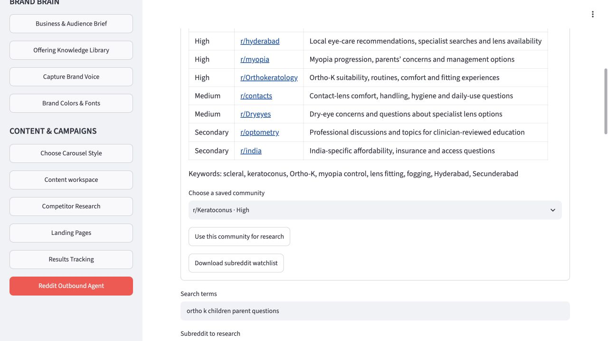
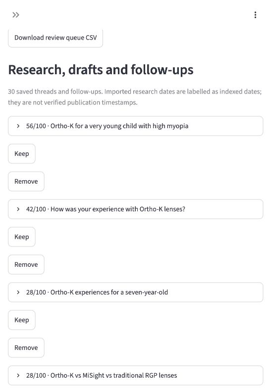

# Reddit Outbound Agent: deployed work

23 October 2026 · GTM Agent

Screenshots from the deployed private app. This public page contains selected product screenshots only.

## Saved subreddit watchlist

A saved watchlist organizes relevant communities, topics and search terms for manual research.

## Research, drafts and follow-ups

30 saved cases, with Keep and Remove controls. Removed cases remain available to restore. The review queue includes draft replies, review status, post age where recorded and manually recorded comment links.

## Current workflow

Research discussions → prepare replies → clinician review → check community rules → manual posting if approved.

Two reply drafts were prepared for review. No Reddit replies have been posted, and automatic Reddit monitoring or posting is not enabled.
