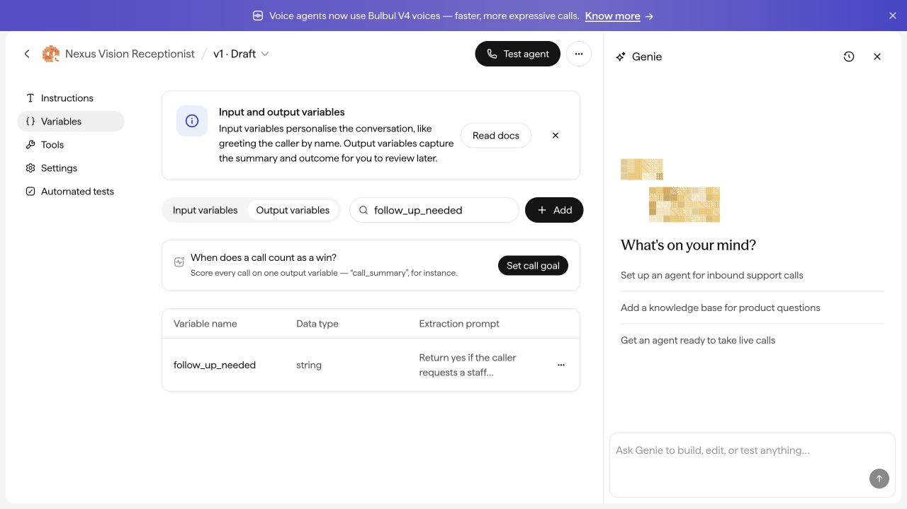

# GTM Agent and Nexus voice agent: work proof

23 October 2026 · GTM Agent

Selected screenshots from the deployed GTM app and the Nexus voice-agent draft configuration.

## Saved subreddit watchlist

A saved watchlist organizes relevant communities, topics and search terms for manual research.

## Research, drafts and follow-ups

30 saved cases, with Keep and Remove controls. Removed cases remain available to restore. The review queue includes draft replies, review status, post age where recorded and manually recorded comment links.

## Current workflow

Research discussions → prepare replies → clinician review → check community rules → manual posting if approved.

Two reply drafts were prepared for review. No Reddit replies have been posted, and automatic Reddit monitoring or posting is not enabled.

## Nexus voice agent: follow-up field

The Nexus Vision Receptionist draft has a `follow_up_needed` output variable configured as a string. This screenshot shows the field configuration; it does not establish live calling, tested extraction, or integration with the GTM app.

