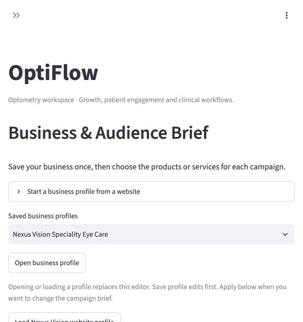
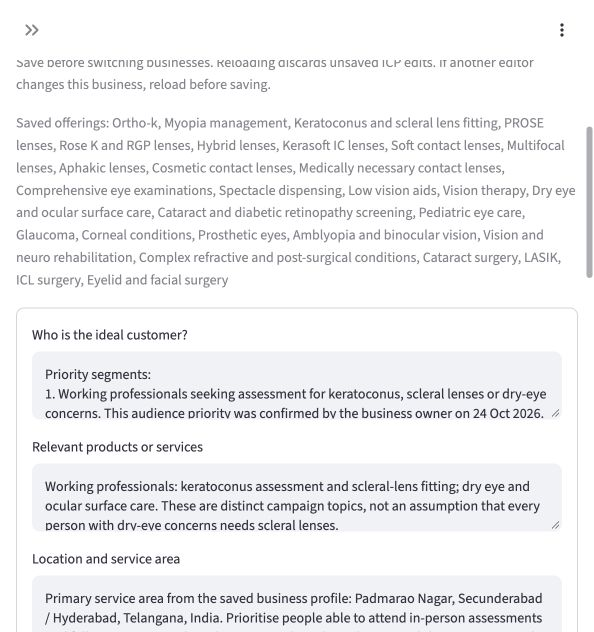
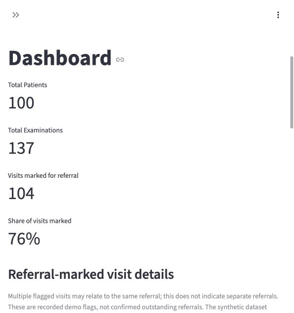
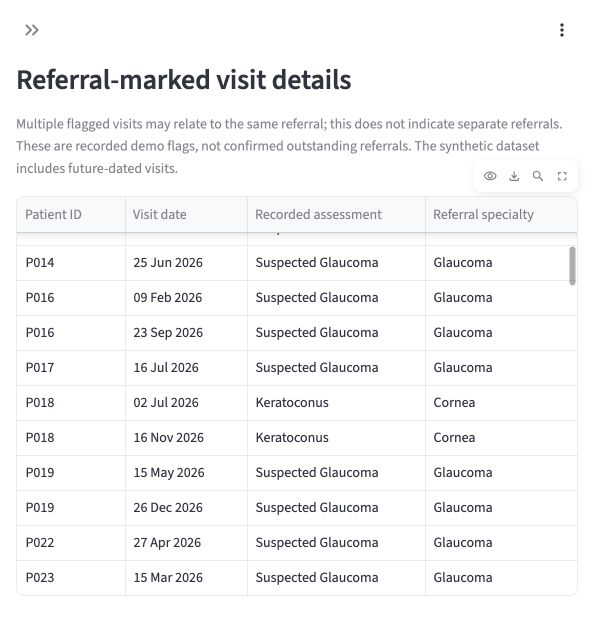
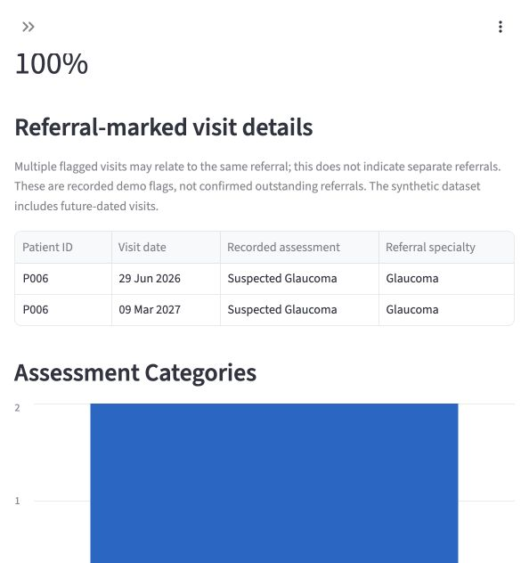

# OptiFlow: deployed workspace progress

**24 October 2026** · Public progress report and screenshots

The GTM project has expanded into **OptiFlow**, a private optometry workspace bringing growth, patient engagement and a synthetic clinical demo together. This page documents today's progress; it is not a claim that a production patient-record system is ready.

[Open the private deployed app](https://gtm-private-review.onrender.com/) (authorised Google sign-in required) · [Previous progress and Reddit screenshots](../2026-10-23/)

## What shipped today

- **Populated Ideal Customer Profile in Brand Brain.** Nexus has a saved, editable profile covering audience, offerings, location, decision makers, needs, outcomes, triggers, objections, criteria, channels, poor fit and evidence. Working professionals are prioritised for keratoconus, scleral-lens and dry-eye campaigns. Assumptions and pending clinical review are explicit.
- **OptiFlow Clinical Workspace integrated into the hosted app.** The demo includes 100 synthetic patients and 137 examinations, visit history, referral information, optional AI/report views and typed examination notes.
- **Clearer referral reporting.** An exact patient selector replaces substring matching. The counter reads “Visits marked for referral.” Each flagged visit shows its date, recorded assessment and specialty. Repeated flags do not imply separate outstanding referrals.
- **OptiFlow branding.** The deployed app is named OptiFlow, with the sidebar heading “OptiFlow Workspace.”
- **Expanded navigation.** AI Search Visibility, Social Media Analyzer and Front Desk are present alongside the existing marketing workflows. Their presence does not imply that every external integration or end-to-end workflow is complete.

## Screenshot gallery

These screenshots were captured from the deployed app on 24 October. All clinical records shown are synthetic. The sidebar is collapsed in content screenshots to keep the narrow browser view readable.

### 1. OptiFlow branding and business brief

### 2. Populated Nexus ICP

Saved audience and offering details, including the working-professional priority. The profile is a draft for review, not clinically validated evidence.

### 3. Clinical dashboard

100 synthetic patients, 137 examinations and a clearly labelled visit-based referral count. These figures are demo data, not clinic performance results.

### 4. Referral detail table

Each flagged visit exposes the recorded assessment and referral specialty.

### 5. P006: why two visits are marked

P006 has two synthetic visits, dated 29 June 2026 and 9 March 2027. Both record suspected glaucoma and the Glaucoma specialty. This is two flagged visit records, not a determination that two separate referrals are needed. The dataset contains future-dated examples.

## Current workspace guide

This inventory describes the current navigation, including features built before today. It should not be read as 16 new features shipped today.

| Area | Tab | Purpose |
| --- | --- | --- |
| Brand Brain | Business & Audience Brief | Save the business, audience and selected offerings for campaigns. |
| Brand Brain | Offering Knowledge Library | Organise offering-specific research and supporting material. |
| Brand Brain | Capture Brand Voice | Record language and tone preferences. |
| Brand Brain | Brand Colors & Fonts | Store visual brand choices. |
| Brand Brain | Ideal Customer Profile (ICP) | Edit and save audience priorities, needs, objections and research assumptions. |
| Content & Campaigns | Choose Carousel Style | Choose the visual direction for carousel content. |
| Content & Campaigns | Content workspace | Work on research-backed content and campaign drafts for human review. |
| Content & Campaigns | Competitor Research | Review competitor positioning and evidence. |
| Content & Campaigns | AI Search Visibility | Workspace for visibility checks and competitor evidence; no guarantee of rankings or AI recommendations. |
| Content & Campaigns | Landing Pages | Work on campaign landing-page material. |
| Content & Campaigns | Results Tracking | Record and review campaign results. |
| Content & Campaigns | Social Media Analyzer | Review social-content insights and hand off findings to campaigns. |
| Content & Campaigns | Social Publishing | Approved manual LinkedIn text publishing. Unattended scheduling is deferred. |
| Content & Campaigns | Reddit Outbound Agent | Saved watchlist, research cases, reply drafts and follow-up review, with Keep/Remove/Restore controls. Kiran posts replies manually. |
| Front Desk | Front Desk | Staff enquiry and follow-up workspace. Full voice-to-calendar booking is not claimed complete. |
| Clinical Workspace | OptiFlow Clinical Workspace | Synthetic examination, history and referral demo, with optional AI views and session-only typed notes. |

### Clinical workspace sections

1. **Dashboard:** synthetic patient/examination totals, filters and referral-marked visit details.
2. **Patient Examinations:** inspect the synthetic examination records.
3. **Patient History:** review visits for a selected synthetic patient.
4. **Ophthalmology Referrals:** explore synthetic referral-directory information.
5. **AI Clinical Summary:** provider-dependent summary interface; provider setup is still required.
6. **Upload Prior Report:** optional provider-assisted review of dummy reports only.
7. **Examination Notes:** type and download draft notes; notes are session-only.

## Working proof from the earlier publishing milestone

[View the Nexus LinkedIn post published through the app](https://www.linkedin.com/feed/update/urn:li:share:7519424798817402880/).

This demonstrates manual LinkedIn publishing, not scheduled or multi-platform posting. [The 23 October gallery](../2026-10-23/) contains the Reddit watchlist and review-queue screenshots.

## Current boundaries and next work

- Private pilot with Google sign-in. Public screenshots do not grant access to the shared workspace.
- Clinical data and referral contacts are synthetic. Real patient records, persistent clinical notes, clinical sign-off and production record controls remain future work.
- Clinical AI requires provider configuration. Voice dictation is not enabled in the hosted clinical workspace.
- Kiran's clinical/content and ICP review remains pending. Reddit replies remain manual and clinician-led.
- Only LinkedIn is connected for publishing. Hosted scheduling and Instagram/YouTube connections remain future work.
- Sarvam voice integration and appointment-calendar linkage need end-to-end confirmation before being presented as a complete booking workflow.

## Release references

The private application release history records the clinical integration (`63191c4`), branding (`c465508`), referral clarification (`778d2f9`) and Workspace capitalisation (`2a38d5c`). Private source links are intentionally not required to view this public evidence page.
